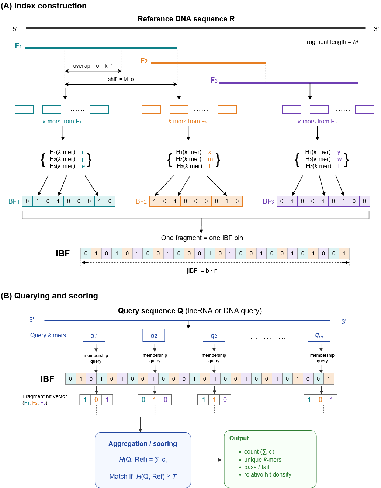

# FragIncRNA

[](https://github.com/GPSeq/FragIncRNA/actions/workflows/cmake-single-platform.yml)


FragIncRNA measures how much of a long non-coding RNA (lncRNA) transcript is
recovered, k-mer by k-mer, in a reference genome assembly. Reference genomes
are split into fixed-size fragments (bins), indexed with an Interleaved Bloom
Filter (IBF), and each query transcript is scored by the fraction of its
k-mer windows that are found in the reference. Candidate loci nominated by the
IBF can be verified exactly against the original reference sequence, so the
final score is free of Bloom-filter false positives.



---

## Contents

1. Method overview
2. Repository layout
3. Installation
4. Input data
5. Quick start
6. Configuring a run
7. Arguments
8. Scoring methods and query classification
9. False-positive and error-rate computation
10. Output files
11. Running many genomes and k values
12. Legacy executable `lncrna_mers`
13. Practical recommendations
14. License

---

## 1. Method overview

For each reference assembly and each query transcript, FragIncRNA performs the
following steps:

1. **Reference fragmentation.** Every contig is divided into bins of
   `fragment_size` bases. A k-mer belongs to the bin that contains its start
   position; the sequence of a bin is extended by `k-1` bases so that no k-mer
   is lost at bin borders.
2. **Indexing.** All valid (A/C/G/T only) reference k-mers are inserted into
   an Interleaved Bloom Filter with one bin per reference fragment. Large
   genomes are split into several independent IBF *shards* (default: at most
   1,000 bins per shard) that are stored on disk and reused between runs.
3. **Query k-mer extraction.** Each query transcript is decomposed into
   overlapping k-mer windows. Windows containing ambiguous bases (e.g. `N`) are
   skipped. By default k-mers are compared in canonical form (a k-mer and its
   reverse complement are treated as identical).
4. **Candidate nomination (per-bin screen).** For every bin `b`, the number of
   query windows that hit the bin (`H_b`) is counted. Bins with at least
   `per_bin_min_hits` hits and at least `per_bin_min_fraction` of the query's
   valid windows are ranked; the best `per_bin_top_k` bins are kept and nearby
   bins on the same contig (gap ≤ `per_bin_max_locus_gap`) are merged into
   candidate loci.
5. **Exact verification.** Candidate loci are read from the original
   reference sequence and every query window is checked for an exact
   occurrence. This removes all Bloom-filter false positives.
6. **Scoring and classification.** The recovery fraction
   (`matched_windows / valid_windows`) is computed and each query is
   classified as `PASS_STRICT`, `PASS_BASIC`, `LOW_SUPPORT`, `NO_MATCH` or
   `NO_VALID_KMERS`.

Optional validation and calibration modes additionally scan the whole
reference exactly, so the IBF result can be compared against ground truth and
empirical false-positive rates can be measured (see
Section 9).

---

## 2. Repository layout

| Path | Content |
|---|---|
| `src/` | C++20 source code of both executables |
| `configs/` | Example and production TOML configuration files |
| `config.toml` | Example configuration for the legacy executable `lncrna_mers` |
| `run_collection/` | Python driver for running many genomes × k values (grid runs) |
| `scripts/` | Helper scripts (FASTA sub-sampling, threshold fitting, merging results, resource measurement, benchmarks) |
| `plots/` | Plotting and summary scripts used for the figures |
| `expression_data/` | Scripts for preparing primate RNA-seq expression support |
| `lncrna_shared_regions/` | Summary of lncRNA regions shared across assemblies |
| `test_data/` | Very small FASTA files for a smoke test |
| `tests/` | Unit and integration tests (run with CTest) |
| `docs/` | Complete reference of all output files, columns and metrics |
| `img/` | Overview figure |

---

## 3. Installation

### 3.1 Requirements

| Requirement | Version |
|---|---|
| CMake | ≥ 3.20 (≥ 3.25 recommended if HIBF is enabled) |
| C++ compiler | C++20 capable; GCC ≥ 12 recommended (GCC 13 tested) |
| zlib | development headers (`zlib1g-dev` on Debian/Ubuntu) |
| OpenMP | optional, enables multi-threaded querying and verification |
| Python | ≥ 3.11, standard library only (helper scripts and tests) |
| git | required at configure time to fetch dependencies |

SeqAn3 (version 3.4.1) is downloaded automatically by CMake during
configuration. No manual installation is necessary.

On Ubuntu / WSL:

```bash
sudo apt update
sudo apt install build-essential cmake git zlib1g-dev gcc-13 g++-13 python3
```

### 3.2 Build

```bash
git clone <repository-url> FragIncRNA
cd FragIncRNA

cmake -S . -B build \
  -DCMAKE_BUILD_TYPE=Release \
  -DCMAKE_CXX_COMPILER=g++-13 \
  -DLNCRNA_MERS_ENABLE_HIBF=OFF
cmake --build build -j 4
```

This creates two executables:

| Executable | Purpose |
|---|---|
| `build/lncrna_mers_v2` | **Main tool.** Recovery scoring, exact verification, validation and calibration |
| `build/lncrna_mers` | Legacy tool (Section 12); kept for reproducibility of earlier results |

### 3.3 CMake options

| Option | Default | Meaning |
|---|---|---|
| `CMAKE_BUILD_TYPE` | – | Use `Release` for real data |
| `BUILD_TESTING` | `ON` | Build the test programs |
| `LNCRNA_MERS_ENABLE_OPENMP` | `ON` | Multi-threading for `lncrna_mers_v2` |
| `LNCRNA_MERS_ENABLE_HIBF` | `ON` | Optional hierarchical IBF for the legacy tool only; requires GCC ≥ 12. Set to `OFF` if not needed |
| `HIBF_LOCAL_SOURCE_DIR` | empty | Use a local HIBF checkout instead of downloading it |

### 3.4 Troubleshooting the build

| Symptom | Solution |
|---|---|
| `HIBF support disabled: GCC 11.x is too old` | Install GCC ≥ 12, or configure with `-DLNCRNA_MERS_ENABLE_HIBF=OFF` |
| `CMAKE_CXX_COMPILER: g++-12 ... was not found in the PATH` | Give the full path, e.g. `-DCMAKE_CXX_COMPILER=/usr/bin/g++-12` |
| Configuration of the fetched SeqAn3 fails with a CMake policy error | Add `-DCMAKE_POLICY_VERSION_MINIMUM=3.5` |
| `OpenMP unavailable: v2 will report and use serial fallback` | Install OpenMP for your compiler (`libomp-dev` for Clang); the program still works single-threaded |
| `Could NOT find ZLIB` | Install the zlib development package |

After changing the compiler, remove the build directory (`rm -rf build`) and
configure again.

### 3.5 Test the installation

```bash
ctest --test-dir build --output-on-failure
```

All tests use small synthetic data and finish within a few minutes.

### 3.6 API documentation (Doxygen)

The source code is documented with Doxygen. With Doxygen installed
(`sudo apt install doxygen graphviz`), CMake provides a `docs` target:

```bash
cmake -S . -B build
cmake --build build --target docs
```

Open `build/docs/html/index.html` in a browser. The documentation contains
this README as start page, the complete output reference, and all classes,
functions and source files. Graphviz (`dot`) is optional and adds class and
include diagrams. Disable the target with `-DLNCRNA_MERS_BUILD_DOCS=OFF`.

---

## 4. Input data

### 4.1 Required inputs

| Input | Format | Notes |
|---|---|---|
| **Reference genome** | FASTA (`.fa`, `.fasta`, `.fna`), optionally gzip-compressed (`.gz`) | One file = one assembly; a file may contain many contigs. Lower-case (soft-masked) bases are accepted. |
| **Query transcripts** | FASTA, optionally gzip-compressed | e.g. GENCODE lncRNA transcript sequences. The query ID is the first whitespace-delimited token of the header; `|` characters are preserved. |

When a whole directory of genomes is analysed (`reference_dir`), every file
with one of the extensions above is treated as a separate assembly. Files
split by chromosome must be concatenated into one FASTA per assembly first.

### 4.2 Optional annotation inputs

| Input | Format | Option |
|---|---|---|
| Reference repeats | BED3/4: `contig start end [class]` (0-based, half-open) | `reference_repeat_bed` |
| Query repeats | BED3/4: `query_id start end [class]` | `query_repeat_bed` |
| Expected loci | BED4/5, tab-separated: `contig start end query_id [label]` | `expected_loci_bed` |
| Exon blocks | TSV with header `query_id query_start query_end contig ref_start ref_end strand` | `exon_blocks` |
| Threshold table | TSV with columns `reference_id k basic_threshold strict_threshold training_control_set` | `threshold_table` |
| Query ID list | Text file, one query ID per line | `window_query_ids` |

All coordinates are **0-based, half-open** `[start, end)`.

---

## 5. Quick start

Run the bundled example (tiny synthetic data, exact mode):

```bash
./build/lncrna_mers_v2 --config configs/example.toml
```

Run directly from the command line:

```bash
./build/lncrna_mers_v2 \
  --reference genome.fa.gz \
  --queries   lncRNA_transcripts.fa \
  --output    results/genome_k20.tsv \
  --k 20 --fragment-size 80000 \
  --mode ibf --scoring-method per_bin_verified \
  --ibf-layout sharded --ibf-shard-dir indexes/genome_k20 \
  --threads 8
```

Analyse every assembly in a directory with a configuration file:

```bash
./build/lncrna_mers_v2 --config configs/multi_genome_sharded_example.toml
```

Show all options:

```bash
./build/lncrna_mers_v2 --help
```

---

## 6. Configuring a run

### 6.1 Configuration file or command line

Every option can be given either in a TOML file (section `[v2]`, option names
with underscores) or on the command line (option names with dashes):

| TOML (`[v2]` section) | Command line |
|---|---|
| `fragment_size = 80000` | `--fragment-size 80000` |
| `per_bin_exact_verify = true` | `--per-bin-exact-verify` |
| `per_bin_exact_verify = false` | `--no-per-bin-exact-verify` |

Command-line options placed **after** `--config FILE` override the values in
the file:

```bash
./build/lncrna_mers_v2 --config configs/mmu8_k20_sharded.toml --k 22 --threads 16
```

The file `configs/example.toml` lists and explains every available option and
is the recommended starting point for a new configuration.

### 6.2 Where to set input and output paths

| What | Single assembly | Directory of assemblies |
|---|---|---|
| Genome(s) | `reference = "path/genome.fa.gz"` | `reference_dir = "path/genomes/"` |
| Transcripts | `queries = "path/lncRNA.fa"` | `queries = "path/lncRNA.fa"` |
| Results | `output = "results/run.tsv"` | `output_dir = "results/"` |
| Index (IBF shards) | `ibf_shard_dir = "indexes/run"` | `ibf_shard_dir = "indexes/"` (one sub-directory per assembly and k) |
| Reference base cache | `reference_cache = "cache/genome.bases"` | `reference_cache = "cache/"` |

Rules:

- `reference` and `reference_dir` are mutually exclusive; so are `output` and
  `output_dir`.
- **Relative paths are resolved from the current working directory**, not from
  the location of the TOML file. Run the program from the repository root, or
  use absolute paths.
- In directory mode, results are written to
  `OUTPUT_DIR/<REFERENCE_ID>/k<K>/results.tsv`. The file name can be changed
  with `output_name_template` (placeholders `{reference_id}` and `{k}`).
- `REFERENCE_ID` is the FASTA file name without its FASTA/gzip extension.
- Use a new output path for every run. Existing results are never replaced in
  directory mode; in single mode they may be overwritten.
- Place indexes on a fast local disk. Index shards are reused automatically
  when the same settings are used again.

### 6.3 Minimal production configuration

```toml
[v2]
# Inputs and outputs
reference      = "genomes/assembly.fa.gz"
queries        = "queries/gencode.v49.lncRNA_transcripts.fa"
output         = "results/assembly_k20.tsv"

# k-mer settings
mode           = "ibf"
scoring_method = "per_bin_verified"
k              = 20
strand         = "canonical"
ambiguity      = "skip"
fragment_size  = 80000

# Bloom filter
hash_functions = 3
fpr            = 0.01

# Index storage
ibf_layout          = "sharded"
max_bins_per_ibf    = 1000
ibf_shard_dir       = "indexes/assembly_k20"
ibf_shard_storage   = "disk"
ibf_shard_retention = "keep"

# Candidate screening and verification
per_bin_min_hits      = 2
per_bin_min_fraction  = 0.02
per_bin_top_k         = 256
per_bin_max_locus_gap = 50000
per_bin_exact_verify  = true

# Classification
basic_threshold  = 0.75
strict_threshold = 0.85

threads = 8
```

---

## 7. Arguments

Default values are given in brackets. Command-line names are shown; the TOML
name is identical with dashes replaced by underscores.

### 7.1 Input and output

| Argument | Description |
|---|---|
| `--config FILE` | TOML configuration file (section `[v2]`) |
| `--reference FILE` | Reference assembly FASTA (`.gz` allowed) |
| `--reference-dir DIR` | Directory of assemblies; one FASTA file = one assembly |
| `--reference-recursive` | Also search sub-directories of `--reference-dir` [off] |
| `--continue-on-reference-error` | Continue with the next assembly after a failure; exit status is still non-zero [off] |
| `--queries FILE` | Query transcript FASTA (`.gz` allowed) |
| `--output FILE` | Main result TSV (single-assembly mode) |
| `--output-dir DIR` | Output root (directory mode) |
| `--output-name-template NAME` | File name of the result TSV in directory mode [`results.tsv`] |
| `--metrics FILE` | Run metrics JSON [`<output>.metrics.json`] |

### 7.2 k-mer and fragment settings

| Argument | Description |
|---|---|
| `--k N` | k-mer length, 1–32 [15] |
| `--fragment-size N` | Reference bin length in bases [8000]; 80,000 is used for whole-genome k=20 runs |
| `--strand canonical\|forward\|both` | `canonical`: k-mer and reverse complement are identical; `forward`: query orientation only; `both`: test both orientations [canonical] |
| `--ambiguity skip\|error` | Skip windows containing non-ACGT bases, or stop with an error [skip] |

### 7.3 Analysis mode and scoring

| Argument | Description |
|---|---|
| `--mode exact\|ibf\|validate\|calibrate\|export-kmers` | See table below [validate] |
| `--scoring-method global_exact\|global_ibf\|per_bin_ibf\|per_bin_verified` | Which evidence defines the primary score (Section 8) |
| `--basic-threshold X` | Minimum recovery fraction for `PASS_BASIC` [0.75] |
| `--strict-threshold X` | Minimum recovery fraction for `PASS_STRICT` [0.85] |
| `--threshold-table FILE` | Per reference / k thresholds; overrides the two values above |
| `--evaluation-control-set LABEL` | Label of the evaluation set; required with `--threshold-table` |

| Mode | What it does | Typical use |
|---|---|---|
| `exact` | Exact scan of the whole reference, no IBF | Small references, ground truth |
| `ibf` | IBF screening (+ exact verification of candidates when `per_bin_verified`) | **Production runs** |
| `validate` | IBF **and** independent whole-reference exact scan; reports all scoring methods side by side | Checking IBF settings on a subset |
| `calibrate` | Like `validate`, plus per-bin false-positive measurements (`<output>.bins.tsv`) | Measuring empirical FPR |
| `export-kmers` | Writes the query k-mers only; no reference needed | Downstream k-mer analyses |

### 7.4 Bloom filter (IBF)

| Argument | Description |
|---|---|
| `--hash-functions N` | Number of hash functions, 1–5 [3] |
| `--fpr X` | Target false-positive rate **per bin**, 0 < X ≤ 0.5 [0.01] |
| `--genome-fpr X` | Target false-positive rate over **all bins** of the genome, 0 < X ≤ 0.5 (Section 9.2) |
| `--ibf-layout sharded\|single\|auto` | Several IBF shards, one IBF, or automatic choice [sharded for new runs] |
| `--max-bins-per-ibf N` | Maximum number of real bins per shard [1000] |
| `--ibf-shard-dir DIR` | Directory for the shards and their `manifest.tsv` [next to the output] |
| `--ibf-shard-storage disk\|memory` | Keep one shard in memory at a time, or all shards [disk] |
| `--ibf-shard-retention keep\|cleanup_on_success` | Keep shards for re-use, or delete shards created by this run after success [keep] |
| `--ibf-shard-reuse` / `--no-ibf-shard-reuse` | Re-use compatible existing shards [on] |
| `--ibf-resume` / `--no-ibf-resume` | Rebuild missing or damaged shards and continue [on] |
| `--ibf-build-only` | Build and validate the index, then exit without querying |
| `--save-index FILE` / `--load-index FILE` | Save or load a single-layout IBF archive |
| `--ibf-auto-tune off\|recommend\|apply` | Diagnose IBF settings and write `<output>.ibf_tuning.json`; `apply` may change the per-bin FPR of `global_ibf` runs [recommend] |
| `--ibf-max-index-memory-gb X` | Refuse to build an index whose bit vectors exceed X GB; 0 = no limit [0] |
| `--ibf-fail-on-unsafe-settings` | Stop instead of warning when the tuner flags unsafe settings |
| `--ibf-dry-run` | Only report the planned index size and settings |
| `--ibf-shard-cache-mb N` | Memory for cached shards in MiB; 0 disables [128] |

### 7.5 Candidate screening and verification

| Argument | Description |
|---|---|
| `--fdr-control-per-bin` / `--no-fdr-control-per-bin` | Enable the per-bin candidate screen. The name is historical: this is **not** statistical FDR control |
| `--per-bin-min-hits N` | Minimum query windows hitting a bin [2] |
| `--per-bin-min-fraction X` | Minimum fraction of the query's valid windows hitting a bin [0.05] |
| `--per-bin-top-k N` | Maximum number of candidate bins per query [64] |
| `--per-bin-max-locus-gap N` | Merge candidate bins on the same contig closer than N bases [50000] |
| `--per-bin-exact-verify` / `--no-per-bin-exact-verify` | Verify candidates exactly against the reference [on] |
| `--per-bin-output FILE` | Per-query candidate summary [`<output>.per_bin.tsv`] |
| `--reference-cache FILE` | Re-usable binary copy of the reference bases used for verification [temporary file] |
| `--reference-page-cache-mb N` | Memory for cached reference pages in MiB [64] |

### 7.6 Repeats and annotation reports

| Argument | Description |
|---|---|
| `--repeat include\|exclude\|annotate` | Keep, remove, or keep-and-report repeat-overlapping windows [include] |
| `--mask-target query\|reference\|both` | Where masking is applied for `exclude` [both] |
| `--reference-repeat-bed FILE` / `--query-repeat-bed FILE` | Repeat annotation; soft-masked (lower-case) bases are always recognised |
| `--repeat-classes FILE` | Query-side recovery per repeat class |
| `--reference-hit-classes FILE` | Repeat classes of the exact reference hits |
| `--fragments FILE` | Coordinates of every reference bin |
| `--positions FILE[.gz]` | Every exact hit position (can be very large) |
| `--local-window N` | Report the best-supported N-base reference region per query |
| `--discover-loci FILE` | Cluster exact hits into ranked loci (`--locus-gap`, `--max-locus-span`) |
| `--expected-loci-bed FILE` | Recovery inside user-supplied expected loci |
| `--exon-blocks FILE` | Recovery at supplied exon-alignment coordinates |
| `--window-output FILE[.gz]` | One row per query k-mer window |
| `--window-scope all\|verified\|candidate\|failed` | Which windows to write [all] |
| `--window-query-ids FILE` | Restrict window output to the listed queries |
| `--window-include-sequence` | Add the k-mer sequence to the window output |
| `--kmer-fasta-output FILE[.gz]` | Write query k-mers as FASTA |

### 7.7 Resources and logging

| Argument | Description |
|---|---|
| `--threads N` | Worker threads; overrides `OMP_NUM_THREADS` [1] |
| `--batch-windows N` | Query windows processed per batch [100000] |
| `--max-query-bases N` | Upper limit on total query bases [50000000] |
| `--max-position-rows N`, `--max-window-rows N`, `--max-ibf-bin-pairs N`, `--max-calibration-pairs N` | Safety limits; exceeding a limit stops the run instead of silently truncating output |
| `--log-file FILE` | Log file [`<output>.log` and `<output>.log.jsonl`] |
| `--log-level trace\|debug\|info\|warning\|error\|off` | Log verbosity [info] |
| `--no-log-to-console` | Write logs to file only |
| `--progress-interval-seconds N`, `--progress-every-queries N` | Progress reporting frequency [10 s, 1000 queries] |
| `--log-per-query`, `--log-per-bin` | Very detailed (and expensive) logging |

---

## 8. Scoring methods and query classification

### 8.1 Definitions

For one query with `N` valid k-mer windows:

| Symbol | Windows counted |
|---|---|
| `G` | positive in **any** IBF bin |
| `C` | positive in at least one **selected candidate** bin |
| `V` | found **exactly** inside the candidate loci (verified) |
| `E` | found **exactly** anywhere in the reference (whole-genome scan) |

Each window is counted at most once, regardless of how many times it occurs
in the reference.

### 8.2 Scoring methods

| `scoring_method` | Recovery | Evidence | Comment |
|---|---|---|---|
| `per_bin_verified` | `V / N` | exact, within candidate loci | **Recommended for production.** No Bloom-filter false positives; a lower bound on whole-genome exact recovery |
| `per_bin_ibf` | `C / N` | approximate | Candidate support without verification |
| `global_ibf` | `G / N` | approximate | Any-bin membership; inflated by false positives on large genomes |
| `global_exact` | `E / N` | exact, whole reference | Ground truth; slow for large genomes |

### 8.3 Classification

Each query receives exactly one status, evaluated in this order:

| Status | Condition |
|---|---|
| `NO_VALID_KMERS` | `N = 0` (query shorter than k or fully ambiguous) |
| `NO_MATCH` | no matched window |
| `PASS_STRICT` | recovery ≥ `strict_threshold` (default 0.85) |
| `PASS_BASIC` | recovery ≥ `basic_threshold` (default 0.75) |
| `LOW_SUPPORT` | otherwise |

---

## 9. False-positive and error-rate computation

FragIncRNA distinguishes between the false-positive rate a Bloom filter is
**designed** for and the error rates that are **measured** against exact
ground truth.

### 9.1 Per-bin design FPR and filter size

`--fpr p` is the target false-positive probability of a single bin. With `h`
hash functions and an upper bound of `n = fragment_size` k-mers per bin, the
number of bits per bin is

```
m = ceil( -h · n / ln(1 - p^(1/h)) )          (minimum 1024 bits)
```

The total index size is approximately `m × number_of_bins / 8` bytes (bins are
padded to multiples of 64). Use `--ibf-dry-run` to see the planned size before
building.

### 9.2 Genome-wide (any-bin) FPR

A query k-mer that is absent from the genome is tested against all `B` bins.
With per-bin FPR `p`, the probability that at least one bin reports a false hit
is

```
independent bins:  P_any = 1 - (1 - p)^B
union bound:       P_any ≤ min(1, B · p)
```

For a mammalian genome with B ≈ 37,000 bins of 80 kb and p = 0.01, `P_any`
is close to 1. This is why `global_ibf` scores are unreliable on whole genomes
and why `per_bin_verified` is the recommended method.

If `--genome-fpr g` is used with `global_ibf` scoring, the per-bin FPR is
reduced so that the union bound holds:

```
p = min( fpr, g / (B · o) )      o = 1 (canonical/forward) or 2 (both strands)
```

After building the index, the **occupancy-based estimate** is computed from
the actual fraction of set bits in each bin:

```
P_any_observed = min(1, Σ_b (occupied_bits_b / m)^h)
```

The run stops if this estimate exceeds `g`. Both values are written to
`<output>.ibf_tuning.json` and the metrics JSON.

### 9.3 Measured error rates (validate and calibrate modes)

In `validate` and `calibrate` mode the whole reference is also scanned
exactly, so every query window has a true label. Per window:

| | exact positive | exact negative |
|---|---|---|
| **IBF positive** | true positive (TP) | false positive (FP) |
| **IBF negative** | false negative (FN) | true negative (TN) |

| Measure | Formula | Reported as |
|---|---|---|
| Genome-wide FPR | `FP / (FP + TN)` = FP / (N − E) | `measured_genome_wide_fpr` (metrics) |
| False-negative rate | `FN / E` | `measured_false_negative_rate` (metrics) |
| Per-bin FPR (one bin) | FP window–bin pairs / absent window–bin pairs | `empirical_per_bin_fpr` (`<output>.bins.tsv`) |
| Pooled per-bin FPR | Σ FP pairs / Σ absent pairs (not the mean of bin FPRs) | `measured_per_bin_fpr` (metrics) |
| Candidate recall | `V / E` | `candidate_window_recall` (main TSV) |
| Per-query FP / FN windows | counts as defined above, per method | `false_positive_windows`, `candidate_false_positive_windows`, … (main TSV) |

Error columns compare different evidence types:

- `false_positive_windows`, `false_negative_windows`: global IBF (`G`) vs exact (`E`)
- `per_bin_ibf_false_*_windows`: candidate IBF (`C`) vs exact (`E`)
- `candidate_false_*_windows`: verified candidates (`V`) vs exact (`E`)

Because the IBF has no false negatives for inserted k-mers, FN for the global
IBF is expected to be zero. Candidate false negatives (`E − V`) arise when a
true occurrence lies outside the selected candidate bins.

### 9.4 What these rates are not

- The **FPR** (`FP / (FP + TN)`) is different from the **false discovery
  proportion** (`FP / (TP + FP)`); they have different denominators.
- None of these values is a biological false-discovery rate. An exact k-mer
  match is evidence of sequence presence, not proof of orthology or of a
  transcribed lncRNA.

---

## 10. Output files

Let `O` be the value of `--output` (for example `results/run.tsv`).

### 10.1 File inventory

| File | Created | Content |
|---|---|---|
| `O` | every run | Main result table, one row per query |
| `O.metrics.json` | every run | Settings, input checksums, aggregate counts, error rates, run time, peak memory |
| `O.log`, `O.log.jsonl` | logging enabled | Human-readable log and one JSON event per line |
| `O.ibf_tuning.json` | IBF modes | Planned/effective IBF design and FPR estimates (Section 9) |
| `O.per_bin.tsv` | per-bin screen enabled | Candidate summary per query |
| `O.per_bin.tsv.candidates.tsv` | per-bin screen enabled | One row per candidate locus (contig, start, end, support, verification status) |
| `O.bins.tsv` | `calibrate` mode | Per-bin occupancy and empirical FPR |
| `manifest.tsv` + shard files | sharded index | In `ibf_shard_dir`; keep the manifest together with the shards |
| `run_manifest.tsv`, `COMPLETED.sha256.tsv` | directory mode | Status and checksums of each completed assembly |
| `*.partial.*` | interrupted run | Incomplete files; never use them as results |

A run is complete when the program exits with status 0 and the log contains
the event `run_completed`.

### 10.2 Main result table (most important columns)

| Column | Meaning |
|---|---|
| `query_index`, `query_id` | Position (0-based) and ID of the query in the FASTA |
| `reference_id` | Assembly ID |
| `k`, `mode`, `scoring_method` | Analysis settings |
| `total_windows` | `max(query_length − k + 1, 0)` |
| `valid_windows` | `N`, windows with only A/C/G/T (after repeat exclusion) |
| `matched_windows` | Windows supported by the selected scoring method |
| `recovery_fraction` | `matched_windows / valid_windows` |
| `status` | Classification (Section 8.3) |
| `exact_global_recovery` | `E / N` (validate/calibrate/exact) |
| `global_ibf_recovery` | `G / N` |
| `per_bin_ibf_recovery` | `C / N` |
| `per_bin_verified_local_recovery` | `V / N` |
| `per_bin_candidate_count` | Number of candidate loci |
| `per_bin_verified_locus_count` | Candidate loci with at least one exact match |
| `candidate_window_recall` | `V / E` |
| `*_status` | Classification of each scoring method separately |
| `result_certainty` | `approximate` or `exact_membership` |

Conventions: values are tab-separated; `NA` means *not available*, not zero;
fractions range from 0 to 1; coordinates are 0-based and half-open.

The complete description of every column, JSON key and log field is in
`docs/OUTPUT_REFERENCE.md`.

### 10.3 Candidate table (`O.per_bin.tsv.candidates.tsv`)

| Column | Meaning |
|---|---|
| `rank` | Rank of the locus (1 = best) |
| `contig`, `start`, `end` | Candidate interval (k-mer start positions) |
| `candidate_bin_count` | Number of merged bins |
| `max_bin_hits`, `sum_bin_hits` | IBF hits of the best bin and of all bins |
| `exact_local_matched_windows`, `exact_local_recovery` | Exactly verified windows in this locus and their fraction of `N` |
| `verification_status` | `VERIFIED` (≥ 1 exact window), `REJECTED` (none), `UNVERIFIED` |

---

## 11. Running many genomes and k values

`run_collection/run_fraglncrna_grid.py` runs `lncrna_mers_v2` for every
assembly in a directory, for a range of k values and hash-function counts.
Each successful job is packed into its own archive with all outputs, logs and
configuration; temporary indexes are removed only after the archive has been
verified.

```bash
# show the planned jobs without running anything
python3 run_collection/run_fraglncrna_grid.py \
  --genomes-dir genomes/ \
  --queries queries/gencode.v49.lncRNA_transcripts.fa \
  --output-dir grid_results/ \
  --threads 15 \
  --k-min 15 --k-max 32 \
  --hash-functions 3 4 \
  --dry-run

# run (remove --dry-run)
```

| Argument | Description |
|---|---|
| `--genomes-dir` | Directory with `.fa/.fna/.fasta[.gz]` files |
| `--queries` | Query transcript FASTA |
| `--output-dir` | Destination of archives and temporary indexes |
| `--threads` | Threads per job |
| `--binary` | Path to `lncrna_mers_v2` [`build/lncrna_mers_v2`] |
| `--template` | TOML template [`run_collection/default.toml`] |
| `--k-min`, `--k-max` | Range of k values [15–32] |
| `--hash-functions` | List of hash-function counts [3 4] |
| `--max-runs` | Stop after N new jobs; 0 = unlimited |
| `--keep-work` | Keep generated configurations and work files |
| `--continue-on-error` | Continue with the next job after a failure |
| `--dry-run` | Print the plan only |

Already finished jobs are detected and skipped, so an interrupted grid can
simply be restarted with the same command.

---

## 12. Legacy executable `lncrna_mers`

`lncrna_mers` is the original implementation. It is kept to reproduce earlier
results; new analyses should use `lncrna_mers_v2`. It reads a TOML file
(default `./config.toml`) with the sections `[general]`, `[ibf]` and `[hibf]`:

```bash
./build/lncrna_mers config.toml
```

| Key | Description |
|---|---|
| `general.index_method` | `"ibf"` or `"hibf"` (HIBF requires a build with HIBF enabled) |
| `general.ref_dir` | Directory with reference FASTA files |
| `general.query_file` | Query FASTA |
| `general.output_dir`, `general.output_file`, `general.log_file` | Output locations |
| `general.fragment_size` | Fragment length (≥ 4) |
| `general.kmer_size` | k, 1–32 |
| `general.hit_threshold` | Minimum summed IBF hits for `<ref>_pass = 1` |
| `general.threads` | References processed in parallel; 0 = all cores |
| `general.store_fragments`, `general.store_index`, `general.cleanup_index` | Keep fragment FASTA / index files |
| `general.single_results_writer` | One combined TSV (`true`) or one TSV per reference (`false`) |
| `ibf.hash_functions`, `ibf.fpr`, `ibf.multi_indexing` | IBF settings |
| `hibf.*` | HIBF settings (`hash_functions`, `maximum_fpr`, `relaxed_fpr`, `threads`, `sketch_bits`, `tmax`, `empty_bin_fraction`, `alpha`, `max_rearrangement_ratio`, `disable_estimate_union`, `disable_rearrangement`) |

Output columns per reference: `<ref>_count` (sum of positive bins over all
query k-mers), `<ref>_ibf_unique_kmer`, `<ref>_pass` and `<ref>_pct`
(`count / number_of_query_kmers`). Because `<ref>_pct` sums bin hits, it can
exceed 1 and is **not** comparable to the recovery fraction of
`lncrna_mers_v2`.

---

## 13. Practical recommendations

- **Settings used for whole primate genomes:** `k = 20`,
  `fragment_size = 80000`, `hash_functions = 3`, `fpr = 0.01`,
  `scoring_method = per_bin_verified`, `ibf_layout = sharded`.
- **Test first.** Run `validate` mode on a few thousand transcripts
  (`scripts/sample_fasta.py` creates a reproducible random subset) and inspect
  `candidate_window_recall` before running the full transcript set.
- **Candidate parameters matter.** Too strict `per_bin_min_fraction` or too
  small `per_bin_top_k` lowers candidate recall (`V / E`). Increase
  `per_bin_top_k` or lower `per_bin_min_fraction` if recall is low.
- **Memory.** `ibf_max_index_memory_gb` limits only the IBF bit vectors, not
  the total process memory. With `ibf_shard_storage = "disk"` only one shard
  is resident at a time.
- **Speed.** Use `--threads`, keep indexes on a local disk, and re-use
  `ibf_shard_dir` and `reference_cache` between runs with identical settings.
- **Exact modes are slow** on large genomes, because every query batch
  requires a full reference scan. Use them on subsets only.
- **Reproducibility.** The metrics JSON records SHA-256 checksums of all
  inputs and the configuration, the software version and the git commit.

---

## 14. License

This project is distributed under the terms of the license in the `LICENSE`
file.
